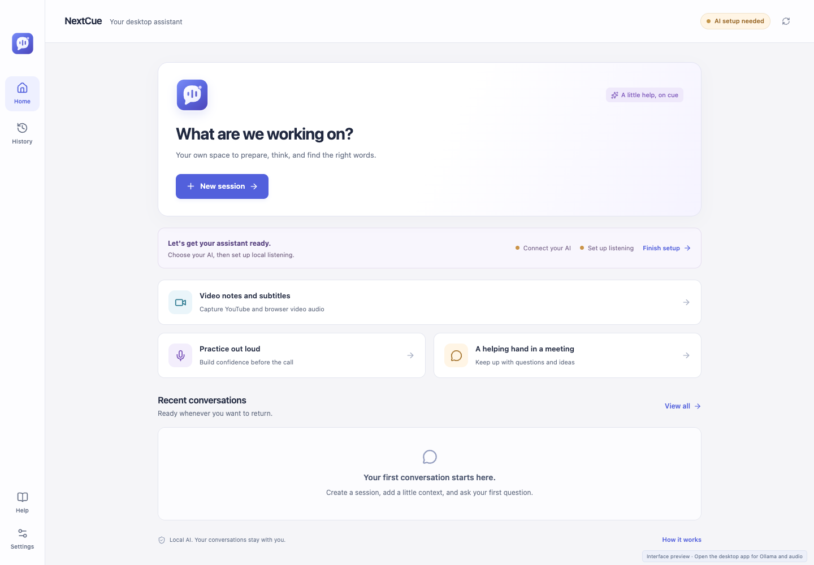
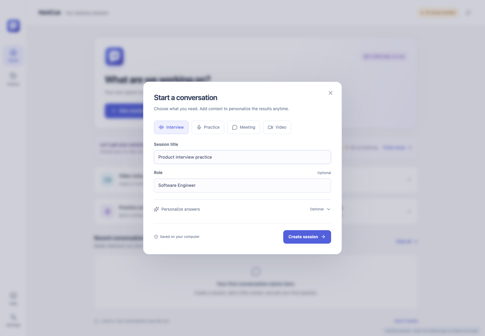
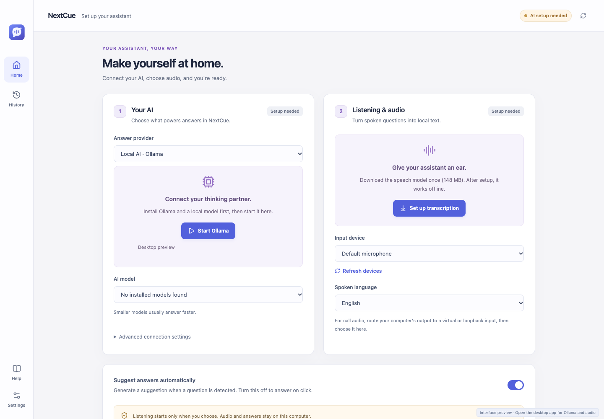

<p align="center">
  
</p>

<h1 align="center">NextCue</h1>
<p align="center"><strong>A little help, on cue.</strong><br />Prepare for conversations. Capture what matters. Keep your next thought within reach.</p>

<p align="center">
  <a href="https://github.com/itfidele/NextCue/actions/workflows/ci.yml"></a>
  <a href="https://github.com/itfidele/NextCue/actions/workflows/package.yml"></a>
  
  <a href="LICENSE"></a>
</p>

<p align="center">
  <a href="#why-nextcue">Why NextCue</a> ·
  <a href="#see-it-in-action">Screenshots</a> ·
  <a href="#get-started">Get started</a> ·
  <a href="docs/USER_GUIDE.md">User guide</a> ·
  <a href="https://github.com/itfidele/NextCue/issues">Feedback</a>
</p>

NextCue is a desktop AI companion for interview preparation, meeting notes, and learning from videos. It turns the audio you choose into a local transcript, then helps you find useful answers or pull out the important points. Keep it beside your work as a floating assistant, or return to your saved sessions later.



## Why NextCue?

**Go into your next conversation prepared.** Practice questions with suggestions grounded in the role, experience, and background you provide.

**Leave a meeting with something useful.** Turn captured speech into decisions, action items, and open questions you can revisit.

**Make video learning easier to review.** Capture browser video audio, generate study notes, and export subtitles for later use.

**Choose how your AI runs.** Ollama answers and Whisper transcription can run locally. Supported ChatGPT and Claude accounts are optional answer providers.

## Find your workflow

| Workflow | Features |
| --- | --- |
| Interviews and practice | Add your role, background, and job description; ask questions or enable automatic answer suggestions. |
| Meetings | Capture transcripts and generate decisions, action items, and open questions. |
| Browser videos | Capture playing audio, create study notes, and export timed SRT/WebVTT subtitles. |
| Floating assistant | Access answers and captions, pause listening, and use configurable shortcuts. |
| Session library | Review saved transcripts and answers, create recaps, and export Markdown. |
| Background work | Keep sessions running through the tray; optionally enable meeting hints or pair the browser companion. |

## See it in action

### Give your session a purpose

Choose Interview, Practice, Meeting, or Video and supply context to guide the assistant.



### Choose your AI and audio

Ollama is the default answer provider. Whisper transcribes speech locally. Settings also supports optional account providers and Jev context help.



These screenshots show the actual web preview with sample session fields. Native audio, AI connections, and local file storage require the desktop app.

## Get started

**Early preview:** run NextCue from source today. Packaged preview builds will be available through [GitHub Releases](https://github.com/itfidele/NextCue/releases) when the author publishes them.

### Run the desktop app

Install Node.js/npm, Rust, and the [Tauri platform prerequisites](https://v2.tauri.app/start/prerequisites/). For local answers, install [Ollama](https://ollama.com/) and download a model:

```sh
ollama pull qwen2.5:7b-instruct
npm install
npm run dev
```

In Settings, check your AI connection and choose **Set up transcription** to download Whisper Base once (about 148 MB). Create a session, select your audio input, and start listening. Manual questions do not require transcription setup.

macOS system audio requires macOS 13 or newer and Screen & System Audio Recording permission. Microphone input requires microphone permission. Windows/Linux call or browser audio requires a selected loopback or virtual audio input.

For interface development only, run `npm run dev:web`.

## Privacy and current limits

- With Ollama selected and Jev disabled, transcription and AI inference stay local. Initial model downloads require internet access.
- Connected ChatGPT/Claude providers receive questions and relevant session context. Jev sends context to TypeSafe. Provider terms and usage limits apply.
- Sessions are saved locally as plain JSON. Audio is processed in memory rather than saved as recordings. NextCue credentials use the OS credential store; Claude Code manages its own login.
- Listening starts from an explicit action or a meeting action you enabled. Meeting hints default to off and indicate app/page presence, not a verified active call.
- Answers and transcripts can contain errors. Speaker diarization, PDF/DOCX resume parsing, and screen-image analysis are outside this version.
- Subtitle timing assumes continuous playback at normal speed. Captions appear in NextCue and export as files; they are not embedded in the source video.
- Visible windows may appear in screen sharing. Use the background/hide workflow and check your sharing preview.

macOS is the current development platform. Windows/Linux native behavior and live paid-account inference still need verification. Commercial distribution with ChatGPT subscription sign-in requires separate provider approval; this project's license does not grant it.

See the [full setup and usage guide](docs/USER_GUIDE.md) for account setup, shortcuts, permissions, exports, and platform limits, and the [browser companion guide](browser-extension/README.md) for optional pairing.

## Development and desktop packaging

```sh
npm run build
npm test
```

With the web preview running in another terminal and Chrome installed, run `npm run test:ui`.

Build on the target operating system:

```sh
npm run package:mac
# Windows: npm run package:windows
# Linux: npm run package:linux
```

### GitHub CI/CD

- **Pull requests and pushes to `main`/`master`:** frontend build, browser-companion tests, UI tests, and Rust tests on macOS, Windows, and Linux.
- **Manual packaging:** run **Package desktop** from [GitHub Actions](https://github.com/itfidele/NextCue/actions/workflows/package.yml) to generate downloadable workflow artifacts.
- **Version tags:** push a matching tag such as `v0.1.0` to run checks, build installers, and attach them to a draft GitHub Release.

| Platform | Packaging output |
| --- | --- |
| macOS Apple Silicon / Intel | DMG for each architecture |
| Windows x64 | NSIS installer (`.exe`) |
| Linux x64 | AppImage and Debian package (`.deb`) |

See the [release guide](docs/RELEASING.md) for versioning, workflow triggers, artifacts, and signing. Generated preview packages are not production signed/notarized; publishing a release is a separate author action.

## Follow along and share feedback

If NextCue interests you, **star the repository** to bookmark it and **watch releases** for updates. Have a workflow you would like it to support? [Open a feature request](https://github.com/itfidele/NextCue/issues/new). For a bug, include your operating system, app version, and steps to reproduce; remove private transcript or account information.

NextCue is created by **Fidele Kirezi Cyisa**. Feedback is welcome; reuse of the source requires permission under the license below.

## Ownership and license

Copyright © 2026 **Fidele Kirezi Cyisa**. All rights reserved.

NextCue's original code, documentation, and assets are proprietary under the [LICENSE](LICENSE). Use, modification, redistribution, and commercial reuse require the author's written permission, except where applicable law permits otherwise. This is not an open-source license. Third-party components retain their own licenses and terms.

This notice reserves rights; it does not transfer third-party ownership or replace contributor agreements. Open-source licenses also preserve copyright ownership, but grant reuse rights. See [reserved rights explained](https://choosealicense.com/no-permission/) and the [U.S. Copyright Office ownership overview](https://www.copyright.gov/what-is-copyright/).
